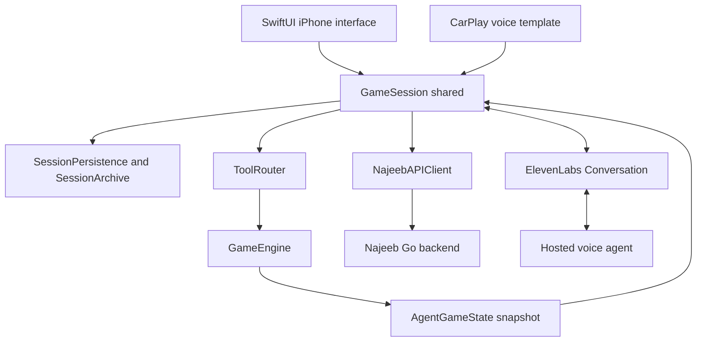
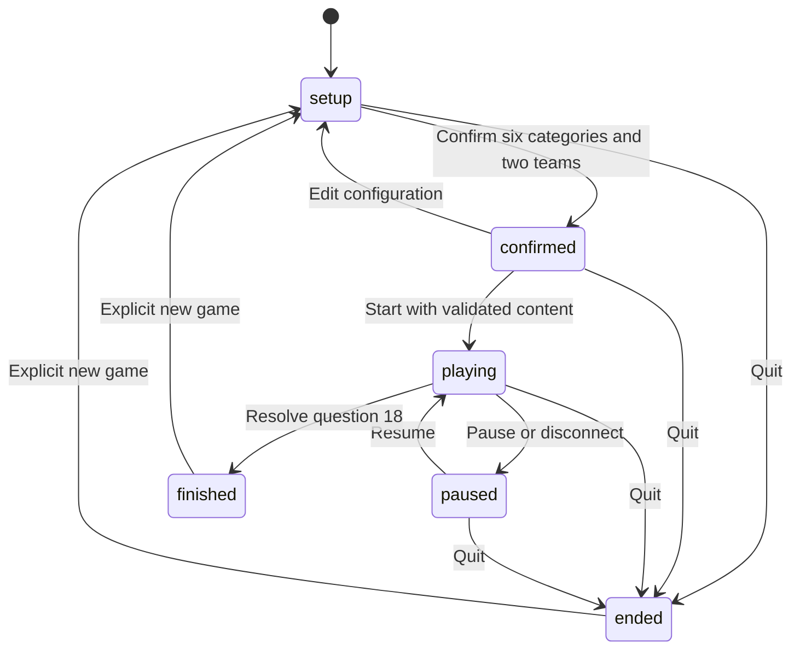

# How Najeeb iOS Works and How to Refactor It

This guide explains the native application with its simplified folder layout on 12 October 2026. It follows a game from launch to the final result, identifies the code responsible for each step, and explains the safeguards that should survive a refactor. The companion [ElevenLabs guide](ELEVENLABS_WALKTHROUGH.md) covers the hosted agent and its settings.

The central design is simple: **ElevenLabs understands the conversation and judges answer meaning; Swift owns the game and applies every state change.** The backend supplies verified questions and generated helpers. The iPhone and CarPlay interfaces observe one shared session.

## Reading order

Read these files in this order to understand the application without starting with its largest file:

1. [NajeebApp.swift](../Najeeb/NajeebApp.swift) and [HomeView.swift](../Najeeb/Views/HomeView.swift): entry point, shared session, visible controls.
2. [Models.swift](../Najeeb/Game/Models.swift): the vocabulary of the game.
3. [GameEngine.swift](../Najeeb/Game/GameEngine.swift): operations, transitions, queue, and scoring. [VoiceInput.swift](../Najeeb/Voice/VoiceInput.swift) contains transcript normalization and activation rules.
4. [ToolRouter.swift](../Najeeb/Game/ToolRouter.swift): JSON arguments become typed operations.
5. [GameSession.swift](../Najeeb/Game/GameSession.swift): connection, tool processing, backend preparation, persistence, and audio.
6. [NajeebAPIClient.swift](../Najeeb/API/NajeebAPIClient.swift), [DrivingQuestionFilter.swift](../Najeeb/API/DrivingQuestionFilter.swift), and [SessionArchive.swift](../Najeeb/Storage/SessionArchive.swift): external content and saved state.
7. [SettingsView.swift](../Najeeb/Views/SettingsView.swift), [DiagnosticsView.swift](../Najeeb/Views/DiagnosticsView.swift), and [CarPlaySceneDelegate.swift](../Najeeb/CarPlay/CarPlaySceneDelegate.swift): secondary interfaces.

## Source folders and test package

All application files compile directly into the **Najeeb** Xcode target. `NajeebCore` and `NajeebContent` are no longer local application dependencies.

| Folder | Contents |
| --- | --- |
| `Najeeb/Game` | Engine, models, typed tools and shared session coordinator |
| `Najeeb/API` | Backend client, response models and question filtering |
| `Najeeb/Voice` | Transcript activation, voice/audio status, sounds and agent configuration |
| `Najeeb/Storage` | Settings and atomic session archive |
| `Najeeb/Views` | SwiftUI views, theme and fonts |
| `Najeeb/CarPlay` | Scene delegate, CarPlay plist and entitlement |

The root `Package.swift` builds a **test-only `NajeebLogic` module** from the same Game/API/VoiceInput files. It has no external dependencies. `swift test` runs the three suites under `Tests/`; the iPhone app is built through `Najeeb.xcodeproj`. This avoids copying the engine while keeping its tests independent of microphone access and SwiftUI. `GameJSONValue` is the application's JSON representation; the specific name avoids colliding with the ElevenLabs SDK's JSON type. Renaming it does not change encoded archive or tool JSON.

## Architecture and ownership



| Component | Responsibility | What to keep out of it |
| --- | --- | --- |
| SwiftUI views | Display state and request actions | Scoring, queue mutation, HTTP requests |
| `GameSession` | Coordinate voice, content, tools, saving, and UI state | Independent copies of game rules |
| `GameEngine` | Apply validated operations and derive the current state | Network calls, ElevenLabs objects, SwiftUI |
| `ToolRouter` | Decode and validate the tool contract | Audio and backend transport |
| `NajeebAPIClient` | HTTPS, cookies, API requests, response decoding, request caching | Team scores and turn progression |
| Hosted agent | Saudi host personality, conversation intent, semantic answer judgment | Directly setting points, teams, progress, or winners |

`GameSession` is an `@MainActor ObservableObject`. SwiftUI receives its `@Published` properties through `@EnvironmentObject`. CarPlay uses `GameSession.shared` directly, so opening a car display does not create another competition or another voice agent.

`GameEngine` is a `Codable` value type. Its stored game fields are private. Callers request a `GameOperation` and receive a `ToolResult`; they do not edit scores or advance the queue themselves. `AgentGameState` is a derived snapshot for views and the agent, rather than a second writable game model.

## Launch and restoring a game

`NajeebApp` creates the shared session as a `@StateObject`, supplies it to `HomeView`, forces right-to-left layout, and applies the light theme and Thmanyah font.

The private `GameSession.init()` performs the following work:

1. Create an initial empty engine snapshot.
2. Create `SessionPersistence` and load its archive if one exists.
3. If the saved phase is `playing`, change it to `paused` and save. A restarted app does not silently continue listening or accepting answers.
4. Publish the restored engine snapshot.
5. Detect old content that requires an explicit new game.
6. Use the fixed production API client, observe audio interruptions, and refresh the local sign-in indication.

If decoding or storage fails, `storageFailed` prevents starting or overwriting the session. This preserves the existing archive instead of replacing it with an empty game.

## Settings and sign in

[AppSettings.swift](../Najeeb/Storage/AppSettings.swift) stores the ElevenLabs agent ID and optional private conversation-token endpoint in `UserDefaults` under `najeeb.settings`. The phone settings UI exposes only the agent ID. The backend is a fixed `GameSession.baseURL` constant: **https://najeb-production.up.railway.app/**. The session owns one nonoptional API client initialized from that valid HTTPS literal. Older saved `backendURL` keys are ignored when decoding and omitted when saving; the agent settings remain compatible.

The reusable content client still validates supplied URLs, but this application always uses the hardcoded production URL. Saved ngrok/local overrides no longer apply. To target a development server, a developer must deliberately change this constant and rebuild. Production login cookies are separate from a previous tunnel’s cookies, so a user may need to sign in again after this change.

`SettingsView` owns temporary form state: email, OTP, optional account name, progress, feedback, and a cancellable task. Its `run` function prevents double taps, dismisses the keyboard, shows progress, and converts failures into inline feedback. Closing the sheet cancels that view's task.

The account flow is:

| Action | API | Native behavior |
| --- | --- | --- |
| Send code | `POST /users/login` | Save the current agent configuration, validate email, send the request, reveal the OTP field |
| Verify code | `POST /users/check_otp` | Validate a six-character alphanumeric code; show a name alert when the backend returns `requires_name`, then resubmit the same email/code with the name |
| Log out | `POST /users/logout` | Clear the relevant session cookie and the API client's prepared/pending game caches |

All OTP requests and verification use the same fixed client/backend. Changing the email resets the OTP form. URL snapshots and backend-switch guards are no longer needed. The backend retains the code while `requires_name` is true. Canceling the alert keeps that code and exposes an “إكمال الحساب” button to reopen it. An empty name disables completion, failures remain visible, and successful login clears the temporary code/name state.

Authentication uses the existing `session_token` cookie through `URLSession`, not a manually stored bearer token. `hasSessionCookie()` checks cookie presence and expiry; it does **not** call a current-user endpoint. Consequently `isSignedIn` is a local hint, while a protected backend request is the actual authentication check.

`saveSettings` now only checks that voice is stopped, saves the agent configuration, and publishes it. It does not recreate the API client, reset the game, or refresh authentication for an unrelated agent change. Settings and account changes still require the voice session to be stopped.

## Pressing Start Game

The primary button in `HomeView` eventually calls `startVoice()`. This starts the conversation, not the eighteen-question competition. Actual competition startup occurs later through the agent's `startGame` tool after setup confirmation.

`startVoice()`:

1. Checks `canStart` and avoids creating a second active conversation.
2. Sets connection indicators and clears transient transcript-authorization state.
3. Increments `sessionGeneration`, which identifies this particular connection attempt.
4. For an empty setup, fetches the actual category catalog and installs it in the engine. Questions always use the media-free voice contract; there is no presentation-mode configuration.
5. Requests microphone permission and prepares the audio session.
6. Resumes a paused engine before connecting, preserving its current question and scores.
7. Encodes the current state and creates `ConversationConfig` with `game_state` and `session_opening`.
8. Connects with the public agent ID, or fetches a token if a token endpoint was configured.
9. Subscribes to the SDK's published events and sends a contextual update telling the host to consult `getGameSummary`.

After asynchronous steps, generation checks prevent an old startup from taking over after Stop or another connection attempt. If a late conversation connects after its generation became invalid, the app ends that conversation.

The fresh `openingMessage` welcomes the players, introduces Najeeb, explains two teams and eighteen questions, then asks which six categories they want. Other branches generate greetings for partial setup, a saved question, an already confirmed game, or an ended competition. Changing the hosted prompt alone does not replace this native greeting.

## Conversational setup

The agent calls `listCategories` before naming catalog entries. The catalog has already been fetched at an empty start; this tool reads the engine's catalog rather than issuing another HTTP request. Suggestions use simple normalized text matching against category names, descriptions, and interests, returning up to three unselected entries.

The host resolves the player's choices to real IDs and calls `addCategory` once per category. Multiple selections in a sentence become sequential tool calls. There is no atomic batch-add operation: a valid first addition can remain selected even if a later addition fails.

The engine requires six distinct categories before `createTeam` can run. The teams receive stable IDs `team1` and `team2`; their names must be nonempty, distinct after normalization, and no more than fifty characters. `renameTeam` supports corrections before play starts.

Each team automatically receives choices, hint, and bomb. There is no helper-selection phase. The host reads the engine's helper rules, introduces the named matchup, reviews the complete setup, and requests approval. `confirmGameSetup(expectedRevision:)` records that approval only if the supplied revision is current.

Category and team edits invalidate confirmation and return the phase to `setup`. The engine enforces completeness and revision validity; the prompt is responsible for obtaining the actual spoken approval.

## Game phases



| Phase | Meaning |
| --- | --- |
| `setup` | Categories and team names can change |
| `confirmed` | Complete setup approved; questions can be prepared |
| `playing` | Questions may be presented and resolved |
| `paused` | Question and scores remain, but answer/helper mutations are rejected |
| `finished` | All eighteen questions resolved; winner or tie available |
| `ended` | Competition quit early; no winner is invented |

`newGame()` replaces the archive explicitly. It is an app action, not a client tool that the model can call spontaneously.

## Loading the eighteen questions

`GameSession.execute()` has special preparation logic for the `startGame` tool. It calls the API only while the engine is confirmed, saves the preparation marker first, and waits for the content before dispatching the core operation.

The request is:

```json
{
  "categories": [11, 12, 13, 14, 15, 16],
  "analytics_game_id": "native-game-uuid"
}
```

The numbers above are illustrative; real IDs come from the catalog. `POST /game/carmode_questions` returns an object whose category-ID keys each contain three questions. The app expects exactly eighteen globally unique IDs, with one question at each real difficulty of 100, 300, and 500 for every selected category.

The separate Go backend implements this in `carmode_questions.go`, with SQL in `sql/queries/carmode_questions.sql`. The backend is not included in this iOS repository. It excludes inactive/deleted/non-CLASSIC questions, nonempty question-media arrays, and any question-side `question_media` record, including audio. Answer media is allowed in the database and omitted from the returned assets. Matching prefers unseen questions while keeping IDs unique across all category slots.

Creation shares the backend's twenty-games-per-twenty-four-hours limit and records question history in a transaction. Insufficient eligible content returns HTTP 422 with `CARMODE_QUESTIONS_UNAVAILABLE` before quota/history changes commit. `analytics_game_id` is for correlation; the route does not provide a backend idempotency guarantee for repeated POSTs.

Native validation adds another layer:

- `DrivingQuestionFilter` checks exact counts, category keys, IDs, actual difficulty, CLASSIC type, empty media, and text compatibility.
- Its word/phrase filter rejects references to images, maps, clips, or listening to recordings. This is a heuristic and can also reject an otherwise valid text question containing those words.
- `GameEngine.installQuestions` validates individual question content. `makeQueue` checks that a complete eighteen-slot game can be formed.

The backend DTO includes `source_difficulty`; it prevents relabeling a question from another difficulty to fill a missing slot. `TriviaQuestion.isCompatibleWithVoiceGame` centralizes the engine eligibility check. Unused answer variants and static hints have been removed: the agent judges against `correctAnswer`, and a requested hint comes from the helper endpoint. Older saved JSON containing the retired fields still decodes.

## Queue order and turn ownership

`makeQueue()` iterates difficulty first, then selected categories in their selection order:

| Questions | Difficulty | Order |
| --- | --- | --- |
| 1 through 6 | Easy, 100 points | Categories 1 through 6 |
| 7 through 12 | Medium, 300 points | The same categories |
| 13 through 18 | Hard, 500 points | The same categories |

The normal answering team is `teams[history.count % 2]`. Team identity comes from the engine, not speaker recognition. Question completion, rather than repeats or conversation turns, advances this sequence.

`getNextQuestion(expectedRevision:)` opens the first slot after starting, or recovers an older saved game between questions. `openNextQuestion()` creates a token such as `turn-3-questionID`. After an accepted answer or surrender, `finishQuestion()` opens the following slot automatically in the same operation; the returned `state.last_answer` describes the resolved question and `state.current_question` contains the following question. A valid `getNextQuestion` request while one is open returns it without advancing. `repeatQuestion` is read-only and works while playing or paused.

## Following one answer through the code

Suppose the reference answer is **جواز** and the current team says **يا نجيب، إجابتنا هي جواز السفر**.

1. ElevenLabs transcribes the speech. The SDK publishes the user message.
2. `observe()` tracks its ID and content, passes it through `VoiceInputGate`, and updates native authorization context.
3. The host compares meaning against `current_question.reference_answer` and requests `submitAnswer` with the full utterance or exact extracted answer, `is_correct: true`, question ID, and turn token.
4. `execute()` checks duplicate IDs and native authorization. `VoiceRequest.matchesAnswer` accepts the normalized full transcript or its matching extracted answer, then the session replaces the operation's answer with the actual full transcript for history. Changing «جواز السفر» to the reference «جواز» still fails correlation; removing the name/submission prefix does not.
5. `ToolRouter.parse()` has already checked the argument names/types and produced `.submitAnswer(...)`. The session passes that typed operation to `engine.perform` after authorization and preparation.
6. The engine validates phase/question/token, checks that an answer exists, and uses the supplied Boolean verdict.
7. `finishQuestion()` awards points, appends one `QuestionOutcome`, and opens the following question with its new team/token, or finishes after question eighteen. Scoring and advancement share one revision and one saved result.
8. The app saves the engine and tool result before sending the result to ElevenLabs. The host announces `state.last_answer` and reads the returned `state.current_question` in the same response, without another tool call or player request to continue. A final result has no current question and includes the engine-derived winner/tie.

**Deterministic scoring does not mean deterministic factual judgment.** The engine does not independently compare the answer with the reference or correct an inaccurate AI verdict. Given the same accepted Boolean and operation, it deterministically applies the same score and turn changes. If you want independently verified grading later, that is a behavior change, not just a refactor.

`AnswerNormalizer` still matters: it normalizes Arabic letters, diacritics, punctuation, whitespace, and digits for transcript correlation, activation parsing, duplicate names, and helper validation. It is no longer the correct-answer grader.

## Voice activation and team discussion

`VoiceRequest` and `VoiceInputGate` live in [VoiceInput.swift](../Najeeb/Voice/VoiceInput.swift). They are transient conversation logic, separate from the stored competition.

| Example during an open question | Native interpretation |
| --- | --- |
| `يا نجيب، إجابتنا هي الرياض` | Directed request |
| `يانجيب، نبي تلميح` | Directed request |
| `ينجيب، إجابتنا هي الرياض` | Directed request |
| `خلنا نتشاور شوي. يا نجيب، إجابتنا هي الرياض` | Directed request; the earlier discussion is excluded from answer extraction |
| `إجابتنا هي الرياض` or `حنا نعتمد الرياض` | Explicit submission without requiring the name |
| `يا نجيب` or `نجيب` alone | Activation; opens an eight-second follow-up window |
| `جواز السفر` immediately after activation | Request while the same turn's window is open |
| `وش رايكم نعتمد الرياض؟` outside that window | Discussion; ignore |
| `يمكن الرياض` outside that window | Discussion; ignore |

The parser recognizes the direct-call forms `يا نجيب`, `يانجيب`, `ينجيب`, and `ي نجيب` anywhere in the transcript, selecting the segment after the last direct call. This handles ASR merging team discussion with a later answer. It strips initial fillers such as `طيب`, `تمام`, and repeated `آآآ` around the call/submission prefix. Bare `نجيب` activates only when it is the entire request. Explicit submission prefixes without a name still begin the request. Common reported/hypothetical calls such as `قال يا نجيب الرياض` are excluded by nearby-word checks; these are heuristics, not full Arabic intent understanding. An incomplete answer prefix opens the window rather than submitting an empty answer.

The gate returns `discussion`, `activation`, or `request`. It refreshes the window when eligible speech arrives and binds authorization to the current turn token. A completed request, token change, native pause/resume, Stop, or disconnection closes it. An accepted request stays authorized while its tool call is processed, even after the listening deadline expires. The gate is not saved to disk.

The app sends `decision`, `request_authorized`, `activation_window_open`, `turn_token`, and `transcript` in contextual updates. `getGameSummary` also returns this under `data.voice_input`. A tool cannot grant its own authorization: `voiceAuthorized` is supplied internally by Swift, and an extra authorization argument from the model is rejected by the router.

There are two output controls: the hosted `skip_turn` tool stays silent for discussion, and native code sets the remote agent track's volume to zero for ignored transcripts. LiveKit's volume setter runs on a serial dispatch queue because it can block its signaling thread. This happens after transcript processing; it is not an offline microphone wake-word detector and does not guarantee rejection before audio reaches ElevenLabs.

The first question explains activation once. Later questions, repeats, and resumed sessions omit that reminder unless players ask. Ambiguous or overlapping authorized speech is handled conversationally by asking for one clear final answer; no reliable speaker identification is implemented.

## Helpers and scoring

The core defines three helpers, once each per team:

| Helper | Preparation | Effect |
| --- | --- | --- |
| Choices | `POST /game/question/choices` with question/category IDs | Four unique nonempty choices, including the canonical answer |
| Hint | `POST /game/question/hint` with question ID | A nonempty hint that does not contain the normalized canonical answer |
| Bomb | No HTTP request | Transfer this question to the other team; correct gains normal points, wrong/surrender loses normal points |

`prepareHelper()` preflights helper availability and current question guards before making a request. The API client checks the response question ID and structure. The engine then validates content and marks the helper used only after acceptance. A failed request or invalid hint/choices does not consume it. The backend's generated hint/choices require its OpenRouter configuration.

The hint check catches literal normalized answer leakage, not every possible semantic disclosure. Keep that distinction if strengthening it later.

A bomb consumes the activating team's bomb, changes the answering team, and appends `-bomb` to the turn token. A second bomb on that question is rejected. The target team can therefore have a negative score. The next normal turn still uses completed-question parity: after a bomb, the same team may answer two consecutive questions.

Ordinary scoring is +100/+300/+500 for correct answers and zero for incorrect answers or surrender. Bomb scoring is the same positive amount for correct, or its negative for incorrect/surrender. `winner` is derived only after all eighteen outcomes exist; a tie has no winning team ID. Early Quit preserves scores/history without inventing a winner.

## Tool processing and duplicate protection

`observe()` subscribes to `$state`, `$agentState`, `$messages`, and `$pendingToolCalls`. The pending-call publisher can emit repeatedly as the SDK's list changes; it is not a one-shot callback.

`drainToolCalls()` uses `processingCalls` to run one drain at a time and a local delivered set to avoid resending the same pending event during that drain. It calls `execute`, records safe diagnostics, and replies with:

```swift
try await active.sendToolResult(
    for: call.toolCallId,
    result: result,
    isError: !result.success
)
```

All game tools require response waiting. The dispatcher rejects a non-waiting game call rather than letting the host proceed without an outcome.

Three guards solve different problems:

| Guard | Purpose |
| --- | --- |
| SDK call ID, optional semantic `request_id`, and saved signatures | Replay the same operation's result; reject a reused ID with different arguments |
| `expected_revision` | Reject stale setup confirmation and question-presentation requests |
| Question ID plus `turn_token` | Reject an answer/helper/surrender for a different question or pre-bomb turn |

The archive stores transport results keyed by SDK call ID. It also searches supplied semantic request IDs before repeating preparation. The engine separately caches mutating operations by their effective request ID. Cached replies contain the snapshot from that operation; after recovering from uncertainty, the host should call `getGameSummary` for the latest state.

## Asynchronous preparation and persistence

Question loading has two cache layers. The API actor shares pending tasks and successful queues by native game ID plus category configuration. The archive saves `ContentPreparation` by the ordered category configuration: `requested`, `ready(questions)`, or `failed(message)`.

The `requested` marker is persisted **before** the POST. If the app dies after the backend commits but before receiving its response, reopening must not blindly create a second game. A saved `ready` queue can be reused. Unknown/interrupted requests and most failures are retained instead of automatically POSTing again. HTTP 401 is a special case: it occurs before protected game creation, so signing in permits retrying the same configuration.

After the question request finishes, the app checks both connection generation and engine revision. Prepared content can be saved without starting a competition if the voice connection was interrupted. Mutation then uses a copy of the previous archive and rolls back if persistence fails.

`@MainActor` does not prevent other actions from running during an `await`. The serial drain, generation checks, revision checks, helper preflight, and final engine validation are therefore meaningful protections, not redundant Boolean clutter.

## What is saved and what is temporary

`SessionArchive` version 1 contains the native game UUID, full engine, transport results/signatures, and content-preparation records. `SessionPersistence` writes it to `Library/Application Support/Najeeb/session.json` inside the app sandbox, using atomic replacement and file protection until first user authentication. The directory is excluded from backup.

The archive includes canonical answers and submitted answers; hiding `reference_answer` in diagnostics does not remove it from persisted game data. The app does not persist microphone recordings. The last sixty transcript messages and forty diagnostic records are temporary memory, separate from the archive; provider-side storage follows ElevenLabs account settings.

Legacy decoding exists deliberately. Old numeric difficulty values and media can still be decoded so names/scores/history survive, but unsupported content requires an explicit restart. Old helper selections migrate to the three defaults; the retired `double` helper is decode-only. `QuestionMedia` and original difficulty metadata remain solely to identify incompatible saved questions. Old presentation-mode keys are ignored when decoding; mode selection and question-playback fields have been removed.

## Pause disconnect Quit and New Game

| Action | Game | Voice connection |
| --- | --- | --- |
| `togglePause()` while connected | Toggle playing/paused; keep the question | Remains connected; sends updated context |
| `stopVoice()` | Pause a playing game and preserve it | End conversation, clear pending observers, release recording/audio |
| Unexpected disconnect | Pause a playing game | Show disconnected status and release audio |
| `quitGame()` | Stop voice, then apply `endGame` | Closed |
| `newGame()` | Replace archive with an empty setup | Must be safe to replace; the UI stops old voice first |

`intentionalStop` distinguishes explicit cleanup from a provider failure. `sessionGeneration` invalidates old asynchronous work. Audio interruptions and media-service resets stop voice and checkpoint the game. Reconnecting creates a new provider conversation, then restores game context from the native archive; it does not resume the previous provider's full conversation memory.

## Answer feedback sounds

[GameSounds.swift](../Najeeb/Voice/GameSounds.swift) owns two bundled [Kenney CC0 cues](https://kenney.nl/assets/interface-sounds): a 0.29-second confirmation and a 0.16-second error sound. [The sound README](../Najeeb/Voice/Sounds/README.md) records the source files, conversion and license. Native playback uses Apple's [AVAudioPlayer](https://developer.apple.com/documentation/avfaudio/avaudioplayer). All player construction, preparation, playback and Stop operations run on one serial audio queue. AVAudioPlayer may activate AVAudioSession synchronously during preparation, so this work must not run on the UI thread. Delegate completion returns to the same queue and resumes the waiting continuation; a two-second watchdog prevents a missing completion from blocking a tool forever. Each play creates a new player so a delayed callback cannot match a reused cached player. `stop()` is asynchronous; the session closes its connection/state guards first, then awaits playback shutdown before ending voice and releasing audio.

`drainToolCalls` considers successful `submitAnswer`/`surrender` results only after the engine/result have been saved. It checks the outcome against the actual latest state and `lastSoundTurnToken` before playing. Startup seeds that token from the saved last answer, preventing an old cue on reconnect. Failed/replayed operations cannot double-award or repeat a cue.

During a cue, `playGameSound` uses the SDK's supported software mute so microphone capture stays running while outgoing frames are zeroed. It ducks the host track, awaits the cue, then restores the previous microphone state before replying to the agent. Generation/connection checks avoid changing a replacement conversation. `stopVoice` stops a pending cue; a microphone-restore failure pauses/disconnects safely. Sound loading failure does not undo a saved game outcome.

`soundEffectsEnabled` uses a separate `najeeb.soundEffectsEnabled` UserDefaults key, defaulting to true; the existing connection-settings Codable format stays intact. Settings exposes the toggle. Diagnostics previews can play either cue without changing the game or requiring a voice/backend connection. Their audio setup/release is protected by `isPreviewingSound`.

## UI audio and CarPlay files

`HomeView` reads the snapshot for scores, current team, question, helper state, and result. Portrait stacks content; landscape places question and controls side by side. The primary button changes among Start, Stop Voice, Pause, Resume, and New Game. iPhone Quit asks for confirmation. Transcript and tool details are in diagnostics rather than the game screen.

[NajeebTheme.swift](../Najeeb/Views/NajeebTheme.swift) centralizes frontend-derived cream, orange (`FA541C`), teal (`00583D`), mint (`007A56`), pink (`D200AE`) and readable difficulty colors, alongside custom fonts and the primary button style. Team 1 uses orange and team 2 teal. The main action stays pinned in portrait; landscape scrolls question/status content independently while keeping the action in its control column. Font and sound resources must remain in the Xcode resource phase. The root SwiftPM package runs only logic tests; it does not bundle or build the app.

[VoiceAudioSession.swift](../Najeeb/Voice/VoiceAudioSession.swift) configures `.playAndRecord`, Bluetooth HFP, and default speaker output. Simulator startup selects LiveKit's platform-default AudioUnit path and video-chat mode; device startup uses default mode. Release stops recording and deactivates the audio session. The newer activation API is guarded by compiler and iOS availability checks. Keep these platform branches when changing audio setup.

CarPlay uses Apple's [CPVoiceControlTemplate](https://developer.apple.com/documentation/carplay/cpvoicecontroltemplate), rather than rendering the SwiftUI game screen. Its delegate creates five voice states, installs a root template, and observes the shared session with throttled status updates. Start is explicit; connecting the car does not automatically start capture. Disconnect stops the shared voice experience. Its controls offer Start/New Game or Pause/Resume and Quit, using supported system icons rather than question media.

The regular `Najeeb` scheme targets iOS 17 with [Info.plist](../Najeeb/Info.plist). `Najeeb-CarPlay` targets iOS 26.4 with [Info-CarPlay.plist](../Najeeb/CarPlay/Info-CarPlay.plist) and the `com.apple.developer.carplay-voice-based-conversation` entitlement in [Najeeb-CarPlay.entitlements](../Najeeb/CarPlay/Najeeb-CarPlay.entitlements). An entitlement entry or successful build does not establish approved provisioning or a working CarPlay scene. Runtime testing remains separate.

## Refactoring plan

The current cleanup removed presentation-mode configuration, unused static question metadata, the duplicate snapshot accessor, and unused authentication/diagnostic fields. It also moved input/audio code into focused files. `execute()` now delegates to `cachedToolResult`, `prepareQuestions`, `prepareHelper`, and `saveToolResult`; argument parsing happens once through `ToolRouter.parse`. The `dispatch` convenience method uses that same parser for direct engine callers and tests.

These are optional further boundaries, not additional components already implemented:

| Extraction | Move from | Keep responsible for |
| --- | --- | --- |
| Voice connection adapter | `GameSession` | SDK startup/events/context/result delivery; keep SDK types here |
| Game content coordinator | `GameSession.execute()` | Saved question preparation and helper fetching |
| Tool execution coordinator | `GameSession` | Serial processing, signatures, replay, authorization, persist-before-reply |
| Injected session store | `SessionPersistence`/session construction | Save/load errors and archive compatibility tests |

Start by moving cohesive code without changing behavior. Preserve the existing `GameOperation`, `ToolResult`, and Codable keys while doing this. Then introduce small dependencies where tests need substitutes: content service, persistence store, and voice connection. You can keep `GameSession.shared` as the production composition point while adding a testable initializer.

Do not extract every function into a class. Keep the engine independent, retain one writable game owner, and make it clear which component serializes tools. Splitting a coordinator into multiple actors without preserving order can create races that the current `processingCalls` and generation checks prevent.

Useful invariants for every refactor:

- One shared game and voice conversation for both interfaces.
- State is saved before a successful tool result leaves the app.
- Repeating/replaying cannot consume a question or award points twice.
- A stale turn cannot answer the next question or the pre-bomb team.
- Failed helper generation cannot consume a use.
- Reconnect restores phase, question, team, and score; it does not restart setup.
- Voice authorization is transient and cannot be supplied by the agent.
- A winner exists only after the eighteenth resolved question.
- Decoding an old archive preserves its useful data, even when play requires a new game.

## Tests and a debugging route

[GameEngineTests.swift](../Tests/Game/GameEngineTests.swift) covers setup, queue/turns, AI verdict application, helpers, duplicate/stale requests, finish/tie, and legacy archives. [VoiceRequestTests.swift](../Tests/Voice/VoiceRequestTests.swift) covers activation parsing, window expiry, and turn isolation. [APIClientTests.swift](../Tests/API/APIClientTests.swift) uses mock HTTP transport for question/helper/authentication contracts.

From the iOS repository root, run all game, voice-input and API tests with:

```sh
swift test
```

[VERIFICATION.md](VERIFICATION.md) records the checks and platform limits. Build the app with Xcode or:

```sh
xcodebuild -project Najeeb.xcodeproj -scheme Najeeb \
  -destination 'generic/platform=iOS Simulator' \
  -derivedDataPath /private/tmp/najeeb-refactor-build \
  CODE_SIGNING_ALLOWED=NO build
```

Documentation changes need no game test rerun. Code refactors should run the relevant package suite and native build; a typed SDK test does not establish microphone recognition, and a CarPlay build does not establish runtime behavior. See the latest verification record for tests/builds after the cleanup. A source refactor and build do not establish fresh spoken-game or CarPlay runtime verification.

For a bug, begin in **المزيد → تشخيص المطوّر**:

1. Check phase, revision, current team, and progress.
2. Check the actual player transcript. An activation or answer recognition problem starts here.
3. Check the tool name, result code, and returned state. `IGNORED_INPUT`, `STALE_QUESTION`, and `INVALID_GAME_STATE` explain different failures.
4. If no tool appeared, inspect the hosted prompt/tool attachment. If a tool failed after preparation, inspect the API contract and safe error.
5. After an interruption, ask for the summary instead of repeating a potentially charged content request.

The diagnostics redact pending `reference_answer` fields and URL query/fragment values. Resolved outcomes can show their correct answer. The remaining structural work is concentrated in the session coordinator: injecting voice/persistence dependencies and testing asynchronous failures would raise its maintainability beyond the current maintainability assessment. A useful next testing boundary is that coordinator itself: fake voice events and save failures can verify ordering and rollback without a real microphone or backend. The existing logic/API tests do not cover every SDK/audio race.

## Where to make a particular change

| Desired change | Start here |
| --- | --- |
| Greeting for a new or resumed game | `GameSession.openingMessage`, then matching agent placeholder |
| Host phrasing, short turns, reminders | Hosted prompt and local prompt source |
| Score values or bomb rules | `Difficulty.points` and engine helper/finish logic |
| Number/order of questions | Backend contract, content filter, engine queue, prompt, and UI progress together |
| Answer intent or activation duration | `VoiceRequest`/`VoiceInputGate` plus hosted instructions |
| Answer judging strictness | Agent prompt/model; engine currently trusts the Boolean |
| Additional game operation | Core operation/router, session preparation if needed, schema, prompt, tests |
| Login/API errors | `NajeebAPIClient`, backend DTOs, `SettingsView` feedback |
| UI colors, fonts, layout | Theme and SwiftUI views |
| Saved format | Archive/version and custom Codable decoders, with migration tests |
