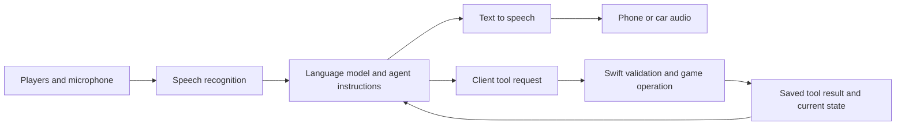
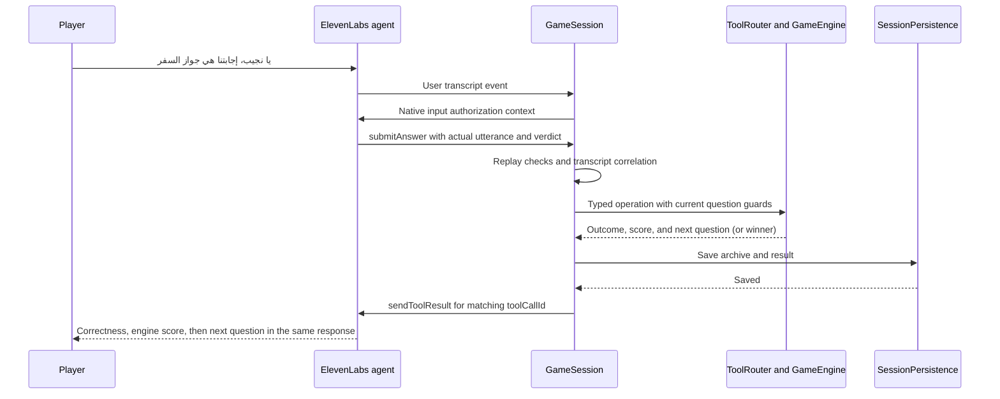

# How ElevenLabs Agents Work in Najeeb

This guide explains the voice agent, its customization settings, and the complete client-tool path in the current Najeeb prototype. Configuration values refer to the local source and latest recorded publication on 12 October 2026. The [app walkthrough](APP_WALKTHROUGH.md) explains the Swift engine, persistence, backend, and interfaces in more detail.

An **agent** is the hosted configuration: instructions, model, voice, recognition settings, tools, and conversation behavior. A **conversation** is a particular running connection with messages, audio, and pending tool calls. The app can reconnect to the same agent through a new conversation while continuing the same native game.

## The voice pipeline



Speech recognition, the language model, and speech synthesis have separate roles. Recognition turns audio into text. The model decides what the players intend, chooses an available tool, and produces host speech. Speech synthesis voices that text. A good-sounding voice cannot fix a bad transcript or an incorrectly described tool.

Najeeb adds native input authorization to this pipeline. Speech still travels to ElevenLabs; after the transcript arrives, Swift decides whether it represents discussion, activation, or a request. It sends that decision as context and controls remote audio output. This is application logic, not an ElevenLabs acoustic wake-word feature.

## Files and the hosted configuration

| Source | Purpose |
| --- | --- |
| [system-prompt.txt](../Najeeb/Voice/AgentConfiguration/system-prompt.txt) | Personality, setup sequence, native authority, answer judging, activation, helpers, reconnect rules |
| [first-message.txt](../Najeeb/Voice/AgentConfiguration/first-message.txt) | `{{session_opening}}`, the native greeting variable |
| [agent.json](../Najeeb/Voice/AgentConfiguration/agent.json) | Model/voice/ASR/turn settings, twenty tool schemas, two built-in tools, variable placeholders |
| [ProvisionAgent.swift](../Najeeb/Voice/AgentConfiguration/ProvisionAgent.swift) | Developer utility that combines those files and prepares API create/update requests |
| [GameSession.swift](../Najeeb/Game/GameSession.swift) | Native connection, event subscriptions, tool execution, results, and runtime context |

The active prototype is **Najeeb Voice Trivia Prototype**, agent ID `agent_0701m4jn0m0ffbb9wr52bf76m447`. The latest recorded automatic-progression update is Main version `agtvrsn_3601m4q2x07jet9tyj2bz4wm6br7`. [Open its dashboard](https://elevenlabs.io/app/agents/agents/agent_0701m4jn0m0ffbb9wr52bf76m447/agent?branchId=agtbrch_2801m4jn0n0yf12a1qzb28jm9se4).

Local files and the dashboard are separate. Editing a text file does not publish anything. Editing a dashboard draft does not update the repository. Keep both aligned and record the actual published version after a change. The native app connects by agent ID; it does not pin this version ID or explicitly choose a branch.

## Starting a native conversation

The app pins ElevenLabs Swift SDK **3.4.0** and LiveKit **2.17.0**. SDK pins exist in the [Xcode project](../Najeeb.xcodeproj/project.pbxproj) and its shared SwiftPM lockfile. The root `Package.swift` only runs the app's logic/API tests and does not depend on ElevenLabs. The SDK's `Conversation` publishes connection state, agent state, messages, and pending client tools; this is the integration surface used by the app. [Official Swift SDK documentation](https://elevenlabs.io/docs/eleven-agents/libraries/swift).

The important startup code is:

```swift
let config = ConversationConfig(
    dynamicVariables: [
        "game_state": safeState,
        "session_opening": openingMessage
    ],
    audioConfiguration: pipeline
)
let active = try await ElevenLabs.startConversation(
    agentId: settings.agentID,
    config: config
)
```

Here `safeState` is encoded `AgentGameState`, not conversation memory. It includes the current question's private judging reference while keeping the rest of the full question bank out of the conversational snapshot. `openingMessage` comes from the native phase-aware greeting. Audio permissions and preparation happen before this call.

The voice SDK path uses WebRTC/LiveKit for this connection. The diagnostics' text box calls `conversation.sendMessage` inside the existing conversation; it does not create another text-only agent or bypass native tool validation. These details follow the pinned SDK implementation and [SDK repository](https://github.com/elevenlabs/elevenlabs-swift-sdk/tree/v3.4.0).

## Public agents and private agents

For this public prototype, an agent ID is sufficient to start the voice connection. It is a configuration identifier, not an API secret. A private agent requires a short-lived conversation token obtained by a backend holding the ElevenLabs API key. [Conversation-token documentation](https://elevenlabs.io/docs/eleven-agents/api-reference/conversations/get-webrtc-token).

The settings UI shows only the voice agent ID (`agent_…`), not an API secret. The game backend is the fixed production URL in `GameSession.baseURL`; the optional private-token endpoint remains internal agent configuration. Old saved backend overrides are ignored.

Najeeb's optional internally configured `tokenEndpoint` invokes an HTTPS endpoint on the fixed production backend host and expects this app-specific response:

```json
{ "token": "temporary-conversation-token" }
```

The app then calls `ElevenLabs.startConversation(conversationToken:config:)`. The backend must implement that adapter and secure access to it; the existing app option does not create a token route automatically. Najeeb content authentication and ElevenLabs conversation authentication are separate: the game backend uses its session cookie, while a private voice connection uses its temporary token. Never embed the provider API key in the iOS app.

## The current settings and what they change

These are current source values, not universal defaults or a guarantee that a particular model will remain available.

| Setting | Current value | What it affects |
| --- | --- | --- |
| Language | `ar` | Arabic conversation configuration |
| LLM | `deepseek-v41-flash` | Intent understanding, semantic judging, tool selection, host text |
| Temperature | `0.35` | Variation in model output |
| Maximum output tokens | `800` | Per-response generation budget; not game duration |
| Parallel tool calls | `false` | Requests should be handled sequentially |
| Voice | Saud — Deep, Formal and Clear | Spoken voice identity; ID `3nav5pHC1EYvWOd5LmnA` |
| TTS model | `eleven_v4_turbo` | Speech generation model |
| Expressive mode | `true` | Expressive voice behavior where supported |
| Speed | `1.1` | Delivery speed |
| Stability | `0.3` | Voice variation/consistency control |
| ASR quality | `high` | Recognition quality configuration |
| ASR keywords | `نجيب`, `يا نجيب`, `يانجيب`, `ينجيب`, `ي نجيب`, `حنا نعتمد`, `إجابتنا هي` | Boost recognition of the name variants and submission phrases |
| Turn eagerness | `patient` | Give players more space to finish speaking |
| Take turn after silence | `20` seconds | Provider's silence-turn timer |
| Silence end-call timeout | `600` seconds | Separate provider inactivity cutoff |
| Maximum conversation duration | `7200` seconds | Two-hour provider conversation cap |
| First-message interruptions disabled | `false` | The opening can be interrupted |
| Client tool response timeout | `20` seconds, or `60` for start/helper | How long the agent waits for an application result |
| `skip_turn.wait_timeout_secs` | `-1` | Skip-turn waiting does not add a periodic spoken reminder |

The latest dashboard verification also recorded Scribe Realtime and PCM 16000 input. Those fields are not explicitly pinned in the local ASR object, which currently specifies quality and keywords. Likewise, the local TTS object does not explicitly set every available voice parameter. Consult the dashboard export for hosted defaults rather than inferring a value from an absent field.

### Personality and game behavior

Customize the **system prompt** for Saudi phrasing, energy, humor, response length, setup order, and when a reminder is spoken. The current instructions welcome players directly into Najeeb trivia, ask for six categories, introduce the two named teams, and explain activation once with the first question.

Keep operational instructions explicit: retrieve the actual catalog, obtain final setup agreement, wait for tool results, use the current question/token, and read engine results before announcing scores or a winner. A prompt controls the model's behavior; native validation still decides whether a requested action is permitted.

### Model selection and judging

Changing the LLM changes more than writing style: it also changes answer judgments and the ability to choose valid tools. Compare candidates with the same transcript cases: equivalent Arabic wording, wrong answers, uncertainty, multiple guesses, helper requests, stale-state recovery, and discussion that should remain silent. Current model-selection options and capabilities are described in the [official models documentation](https://elevenlabs.io/docs/eleven-agents/customization/llm).

Najeeb's current semantic policy accepts **جواز السفر** for **جواز** when both mean a passport. It should reject related but wrong facts, contradictory extra claims, and mixed lists of guesses. An unclear final answer should lead to clarification, not an immediate false verdict. The engine applies the Boolean verdict and does not independently verify it.

Temperature and maximum tokens do not enforce brevity or correctness on their own. Short spoken turns are principally a prompt instruction; result validation and persisted state supply the application guarantees.

### Voice and speech recognition

Customize the voice, TTS model, speed, stability, and available expressiveness controls to change delivery. Audition question text, Arabic names, category names, and numbers with the actual voice/model combination. The voice identity and Arabic prompt together shape the host, while recognition quality controls the incoming transcript. [Voice customization documentation](https://elevenlabs.io/docs/eleven-agents/customization/voice).

Keywords are recognition hints. They do not authorize an answer or make the microphone stop transmitting background discussion. If a transcript repeatedly misses **نجيب**, inspect recognition first; if the transcript is correct but the model answers discussion, inspect activation context, prompt, and `skip_turn`.

### Turn taking and silence

Patient turn behavior allows longer pauses before the host responds. Take-turn timeout, silence-disconnect timeout, and maximum call duration are separate settings. The local eight-second activation window is another independent timer. Its duration does not come from the ElevenLabs dashboard. [Conversation-flow documentation](https://elevenlabs.io/docs/eleven-agents/customization/conversation-flow).

The prompt tells the host not to invoke `end_call` merely because players are thinking. That does not cancel provider limits: the configured 600-second silence cutoff or 7200-second conversation cap can still end the connection. Native state then remains available for reconnecting. Keep thinking-time behavior in mind when changing these timers.

### Dynamic variables and overrides

Dynamic variables substitute values into instructions and the first message through syntax such as `{{game_state}}`. Dashboard placeholders are development fallbacks; the app supplies real values when connecting. They are not a live database subscription. Subsequent state arrives through tool results and `updateContext`. [Dynamic-variable documentation](https://elevenlabs.io/docs/eleven-agents/customization/personalization/dynamic-variables).

An override replaces an entire configured field, such as the prompt or first message, when its security permissions allow it. This app uses variables for personalization rather than replacing the whole prompt. Do not enable broad overrides just to change a greeting. [Overrides documentation](https://elevenlabs.io/docs/eleven-agents/customization/personalization/overrides).

### Knowledge and workflows

The current local configuration does not attach a knowledge base or implement a hosted workflow graph. It uses one host prompt plus native game tools. Do not put the competition state or a duplicated question bank into a prompt/knowledge base and expect it to remain synchronized. If adding hosted workflows later, keep native mutations and results as the authority for turns, points, and completion.

## What a client tool actually is

A client tool has two sides:

1. The hosted schema tells the model its name, purpose, argument types, required fields, and whether to wait.
2. The native implementation receives the requested name and arguments and performs the action.

Adding a schema does not create Swift code. Naming a Swift function does not automatically expose it to the agent. Tool and parameter names are case-sensitive, and response-waiting results are added to the conversation context. [Client-tool documentation](https://elevenlabs.io/docs/eleven-agents/customization/tools/client-tools).

For Najeeb, `submitAnswer` is a **client** tool even though other client tools may use the backend. The request reaches the iPhone first; Swift controls whether any HTTP request or engine operation occurs. A webhook/server tool would instead execute through the hosted service. `skip_turn` and `end_call` are built-in **system** tools executed by ElevenLabs, not entries in `ToolRouter`.

The model chooses a tool from its descriptions, instructions, conversation, and recent results. It emits a structured tool call, not a magic text command. Saying the tool's name out loud is not required of a player.

## The complete Najeeb client tool catalog

All twenty tools wait for a response. The shared optional `request_id` on mutation schemas identifies a semantic retry; normally the app uses the SDK call ID. Native validation ultimately checks what was supplied.

| Tool | Required arguments | Purpose |
| --- | --- | --- |
| `listCategories` | None | Read the real engine catalog |
| `getCategorySuggestions` | `interests` | Return up to three real unselected suggestions; interests may be empty |
| `addCategory` | `category_id` | Add an actual distinct category during setup |
| `removeCategory` | `category_id` | Remove a selected category during setup |
| `getSelectedCategories` | None | Read current selections and remaining count in state |
| `createTeam` | `name` | Create the next team after six categories |
| `renameTeam` | `team_id`, `name` | Change a team name before play |
| `listHelpers` | None | Read the three defaults and their real rules |
| `getGameSummary` | None | Read authoritative state; app adds `data.voice_input` |
| `confirmGameSetup` | `expected_revision` | Confirm the complete, verbally reviewed setup |
| `startGame` | None | Prepare eighteen questions and start the confirmed game |
| `getNextQuestion` | `expected_revision` | Open the first slot or recover older between-question state; return an already open question unchanged |
| `submitAnswer` | `answer`, `is_correct`, `expected_question_id`, `turn_token` | Record judgment/points and return the following question, or finish |
| `surrender` | `expected_question_id`, `turn_token` | Resolve and return the following question; bomb can deduct points |
| `repeatQuestion` | None | Return the same question without advancing |
| `useHelper` | `helper_id`, `expected_question_id`, `turn_token` | Use `choices`, `hint`, or `bomb` for the current team |
| `getScoreboard` | None | Read real teams and scores |
| `pauseGame` | None | Preserve the question and pause game mutations |
| `resumeGame` | None | Resume that same game |
| `endGame` | None | End early without declaring a winner |

`selectHelper`, `removeHelper`, `configureHelpers`, and `playQuestionAudio` belong to older versions and are not current client tools. `newGame` is a native control, not an exposed client tool.

## A tool call from model to Swift and back



Transcript and tool events can arrive close together or out of order; the diagram shows the logical dependency, not a guaranteed wire ordering. Native code waits up to fifteen 50-millisecond intervals for the authorized matching transcript before rejecting a player-request tool against stale text.

The SDK publishes `ClientToolCallEvent` objects in `conversation.$pendingToolCalls`. Important fields used here are `toolName`, `toolCallId`, `parametersData`, and `expectsResponse`.

`GameSession` keeps one drain running. For each call, it decodes `[String: GameJSONValue]`, checks saved signatures/results, and calls `ToolRouter.parse` once. The resulting typed operation passes through native authorization and content preparation before `engine.perform` returns `ToolResult`. `prepareQuestions`, `prepareHelper`, and `saveToolResult` keep those steps explicit inside the session.

The result envelope contains:

| Field | Meaning |
| --- | --- |
| `success` | Whether the requested operation succeeded |
| `code` | Stable machine-readable result or failure reason |
| `message` | Safe explanatory text; ignored input intentionally uses an empty message |
| `state` | Authoritative `AgentGameState` after the operation |
| `data` | Tool-specific catalog, question, outcome, helper content, or voice-authorization details |

After saving, the app invokes `sendToolResult(for:result:isError:)` with the matching call ID and `isError: !result.success`. The pinned SDK encodes the `Encodable` result to JSON and removes that call from the pending list after publishing it. A no-response call can be marked complete, but Najeeb rejects non-waiting game tools because the host needs their outcomes.

If response delivery fails after saving, the native mutation is still committed. The app stops voice; a replay returns the saved result rather than scoring again. This is why result delivery must stay after persistence during a refactor.

Najeeb also plays a short native correct/wrong cue after saving a new answer outcome and before delivering its result. `AudioPipelineConfiguration.useSoftwareMute` lets `setMuted` zero outgoing microphone frames during that cue while capture stays running; the app restores the previous state afterward. The host track is ducked briefly. There is no additional agent sound tool or hosted configuration change: the engine outcome triggers feedback locally, and duplicated calls/reconnects do not replay it. Settings can disable effects; Diagnostics can preview them.

## Configuring a tool correctly

An abbreviated schema for an answer has this shape; see `agent.json` for all descriptions and optional retry fields:

```json
{
  "type": "client",
  "name": "submitAnswer",
  "description": "Record the semantic judgment for the actual authorized player answer.",
  "expects_response": true,
  "response_timeout_secs": 20,
  "parameters": {
    "type": "object",
    "properties": {
      "answer": { "type": "string" },
      "is_correct": { "type": "boolean" },
      "expected_question_id": { "type": "string" },
      "turn_token": { "type": "string" }
    },
    "required": ["answer", "is_correct", "expected_question_id", "turn_token"]
  }
}
```

Use descriptions to explain **when** to call a tool and **where arguments come from**. For example, the turn token must be copied from the latest result, not invented, and `answer` must preserve the actual utterance rather than prepend a wake name or replace it with the reference answer.

Current clients also use `pre_tool_speech: off`, `execution_mode: immediate`, and `interruption_mode: allow`. This avoids a stock announcement before every operation and lets the conversation remain interruptible. Error handling is configured as passthrough; native failures still return their explicit structured result. These settings do not remove native ordering, argument checks, or game-state guards.

Use the longer sixty-second timeout for `startGame` and `useHelper`, which can await HTTP work. Local operations use twenty seconds. The API client's own HTTP request/resource limits are separate; raising an agent timeout cannot repair an unreachable server or a malformed response.

## Native authorization and the reference answer

The host must distinguish discussion from a final answer. Direct calls **يا نجيب**, **يانجيب**, **ينجيب**, and **ي نجيب** can occur anywhere in a transcript, including after earlier discussion. The request follows the last direct call. Explicit prefixes such as **حنا نعتمد** or **إجابتنا هي**, or a follow-up in the native eight-second activation window, also work. The actual current-turn authorization is sent through `updateContext` and `getGameSummary.data.voice_input`.

An activation-only message receives a short acknowledgment or request for the missing answer, rather than `submitAnswer`. An unauthorized discussion message calls `skip_turn` with no game action. A speculative or overlapping authorized message should obtain a clear final answer before grading.

The reference answer is supplied in `current_question.reference_answer` for semantic judgment. It must not be spoken before resolving the question. The full player utterance or exact extracted answer and the model's Boolean judgment go to `submitAnswer`. Swift correlates it against the latest native-authorized transcript, stores that actual transcript in history, and owns points. For example, `جار` matches `يا نجيب، إجابتنا هي جار` even after preceding discussion. A different canonical answer or only one guess from a mixed answer does not match. Tool results may reveal the resolved correct answer afterwards. Successful answer/surrender results also contain the already prepared following question. The host must announce the outcome and read that question immediately in the same response; it must not wait for a new activation or ask whether to continue. Only after reading it does the host wait for the next team’s answer. Question eighteen finishes with `state.winner` and no following question. An older app returning playing with no current question still needs an immediate `getNextQuestion` call.

This boundary has practical limits. Swift prevents invented authorization, stale turns, and double scoring, but it trusts the semantic verdict. Native remote-track muting supplements silence instructions after transcript arrival; it cannot guarantee that a model never starts speaking before classification.

## Built in system tools

`skip_turn` produces no ordinary host response and is the mechanism used when players are discussing an answer. Its current description follows native authorization, and `wait_timeout_secs: -1` avoids periodic skip-turn reminders. It is distinct from ending the voice connection. [Skip-turn documentation](https://elevenlabs.io/docs/eleven-agents/customization/tools/system-tools/skip-turn).

`end_call` disconnects voice. It does not perform the native `endGame` operation. For an explicitly quit unfinished competition, the host must successfully call `endGame` first and then `end_call`. Pausing, a tool error, or finishing the final celebration is not an instruction to discard the game. Provider call limits remain separate from these model-selected tools.

## Reconnect and continuing the same game

A new connection receives a fresh native greeting and serialized state. The agent then calls `getGameSummary`. If a question is active, it uses `repeatQuestion`, not setup or another queue slot. If play is between questions, it uses `getNextQuestion` with the latest revision. A finished/ended game is described according to its actual phase.

`updateContext` carries native pause/resume and input-authorization updates within an existing conversation. It supplies context rather than submitting a player's answer. Starting another provider conversation does not recover its old conversational memory; the archive and state tools recover the competition.

Avoid a fixed first message such as “choose your categories” for every connection. The current `{{session_opening}}` exists specifically to preserve this distinction. A native greeting change needs an app build; a published prompt/model change is picked up by a new voice connection. Neither automatically resets the game.

## Changing and publishing configuration

For a prompt or settings change:

1. Update the relevant local source. Keep the prompt copy inside `agent.json` synchronized with `system-prompt.txt`.
2. Make the matching dashboard change on the intended agent/branch. Keep `{{session_opening}}` as the first message.
3. Review the publication diff, including Raw JSON for fields omitted from a friendly overview.
4. Publish, then export the current configuration and compare the prompt, greeting variables, tools, and settings.
5. Record the deployed agent version in your local development notes and reconnect voice before evaluating behavior.

Versions are immutable configuration snapshots; drafts, branches, and traffic deployment are separate concepts. Publishing on an unselected branch need not change the branch serving app connections. Najeeb currently relies on the hosted routing configuration because its startup passes only the agent ID. [Agent-versioning documentation](https://elevenlabs.io/docs/eleven-agents/operate/versioning).

Client tool definitions may be shared by dependent agents in the dashboard. Inspect dependents before changing a shared schema or description. Removing a tool attachment from Najeeb is different from deleting its global definition. The previous setup/media tools were detached rather than globally deleted.

### The provisioning utility

`ProvisionAgent.swift` loads `agent.json`, replaces the embedded prompt and first message from the two text files, and validates unique client names, response waiting, and object schemas. Built-in tools live separately under `built_in_tools`, not in the client-tool array.

From the workspace root, compile and inspect a request without a key or network mutation:

```sh
xcrun swiftc -parse-as-library Najeeb/Voice/AgentConfiguration/ProvisionAgent.swift \
  -o /private/tmp/najeeb-provision-agent
/private/tmp/najeeb-provision-agent --dry-run \
  --config Najeeb/Voice/AgentConfiguration/agent.json
```

Without `--dry-run`, it reads `ELEVENLABS_API_KEY` from the terminal environment. Omitting `--agent-id` sends a create request; supplying it sends an update request. `--voice-id` or `ELEVENLABS_VOICE_ID` can override the request's voice. Keep credentials outside source control and outside the app.

This is a small provisioning helper, not complete branch/deployment automation. It does not reconcile shared global tools, choose a branch explicitly, or verify served traffic after an update. For the versioned prototype, the established dashboard publication/export workflow remains the verification path. After an uncertain create response, inspect the dashboard before creating again.

## Adding or changing a tool

A complete tool change touches several contracts:

1. Define the typed `GameOperation` and its engine rules/result, if it changes the game.
2. Add the router name and strict argument parsing in `ToolRouter.parse`; the convenience `dispatch` method reuses it.
3. Add session-side authorization or asynchronous preparation where required; preserve saving and replay behavior.
4. Add/update the local client schema and the hosted definition, including required argument descriptions and response waiting.
5. Update host instructions about when to use it and how to react to failure.
6. Test invalid arguments, phase/token/revision errors, duplicate delivery, persistence failure, and a connected conversation.

An extra `voice_authorized: true` argument is not a valid shortcut. Only native transcript classification supplies that internal decision. Similarly, a score argument cannot change points unless you deliberately change the engine contract.

## Troubleshooting by symptom

| Symptom | Inspect first | Likely distinction |
| --- | --- | --- |
| Host asks “what should we play?” | Native `openingMessage`, supplied variable, published prompt | An old app can still send the old greeting despite a newer hosted prompt |
| Reminder repeats after every question | Published activation instructions | Old prompt or wrong served version |
| Resume starts category setup | Startup state, `getGameSummary`, greeting | Missing/stale state or instructions; provider conversation memory is not the archive |
| Name or answer appears wrong | Diagnostics transcript and ASR keywords | Recognition issue before judging |
| Correct transcript gets ignored | Gate decision, activation timing, question token | Native authorization rather than answer correctness |
| No tool is requested | Hosted attachment, name, description, prompt | A Swift operation alone is not exposed |
| `INVALID_ARGUMENTS` | Required fields/types and router | Schema and implementation disagree |
| `STALE_REVISION` or `STALE_QUESTION` | Latest summary and guards | A cached or pre-bomb state was used |
| Host says success but score did not change | Actual tool result and `success` | Model narration is not proof of a mutation |
| Helper fails | Backend cookie, endpoint, OpenRouter setup, returned content | Generation/validation failure; use should remain available |
| Tool times out | Native result log, network work, SDK connection | Do not automatically repeat a potentially committed game POST |
| Microphone cannot start | Permission, audio route, LiveKit/native error | A model or prompt change will not fix local audio startup |
| Connection ends during silence | Inactivity timer and call-duration cap | Provider limits can close a connection even without `end_call` |

Start with native diagnostics, then inspect the same conversation in the ElevenLabs dashboard. Check actual tool arguments/results and which agent configuration served that conversation. Dashboard Preview can audition personality and speech, but cannot by itself execute the Najeeb iPhone's local engine or validate persistence.

## A practical acceptance sequence

Use native diagnostics text messages to isolate model/tool behavior, then repeat with microphone speech:

1. Fresh welcome goes directly to six categories, with suggestions drawn from the actual catalog.
2. Multiple selections and a replacement update the actual count; fewer than six cannot start.
3. Two names are saved and introduced; helpers are automatic; final setup is confirmed.
4. Question 1 explains activation once. Question 2 omits it.
5. **جواز السفر** is accepted against **جواز**, while a clear wrong answer gets a false verdict.
6. Discussion is silent; explicit submission phrases work; name-only activation permits a follow-up within eight seconds and expires afterwards.
7. Repeat, hint, score, pause/resume, bomb, and reconnect preserve the appropriate state.
8. Failed or duplicated tools do not consume helpers, advance twice, or double-award points.
9. Question 18 yields the engine's winner/tie. Early Quit yields no invented winner.

The [verification record](VERIFICATION.md) includes typed connected-agent semantic checks and game/API tests. Typed checks establish the real model/tool/engine path, not Saudi microphone accuracy, overlapping-speaker behavior, audible silence, or CarPlay runtime. Use [VOICE_TEST_MATRIX.md](VOICE_TEST_MATRIX.md) for the remaining spoken scenarios.

## Choosing the correct place for a change

| Change | Hosted agent | Native app or backend |
| --- | --- | --- |
| Humor, welcome wording, brevity, reminder frequency | Prompt | Native opening also needs updating when its text changes |
| Voice timbre or speed | Voice/TTS settings | No engine change |
| Recognition of Najeeb's name | ASR keywords/settings | Gate still defines accepted forms |
| Activation window length | Explain the new rule in the prompt | Change `VoiceInputGate` and tests |
| Semantic answer tolerance | Prompt/model and evaluation cases | Engine currently records the verdict |
| Points, helper limits, bomb mechanics | Explain engine-returned rules | Change the deterministic engine |
| Catalog, content eligibility, number of questions | Keep instructions consistent | Backend/filter/queue/UI contract changes |
| New game action | Explain native control if necessary | Archive replacement and UI |
| Connection access/retention | Authentication/privacy settings | Optional secure token service and account behavior |
